<div align="center">

# Assembly Line Balancer

**Balance an assembly line against takt time. Compare the classic textbook heuristics with an exact optimisation model, see the result as yamazumi and Gantt charts, and export it.**

[](https://www.python.org/)
[](https://streamlit.io/)
[](https://developers.google.com/optimization)
[](#tests)
[](#results-on-textbook-benchmarks)
[](LICENSE)

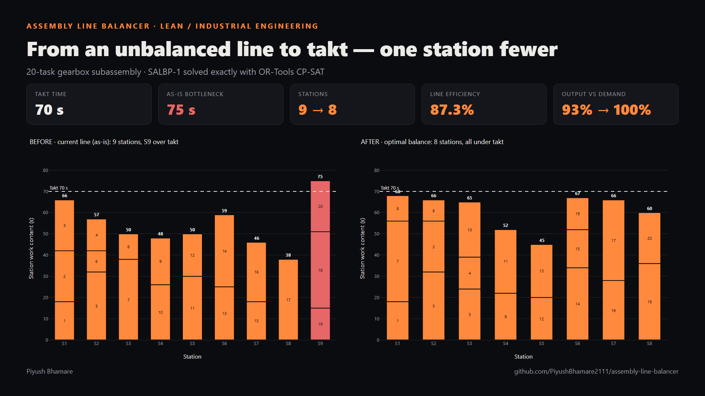

</div>

## Why this exists

Line balancing is something I have done by hand on the shop floor. At my internships I ran time studies, redesigned fixtures (cutting 7 min/unit of cycle time) and standardised SOPs, which improved line balance and cut rework by 25%. On the floor the method was a stopwatch, a spreadsheet and a yamazumi board.

This tool takes those same steps (time-study data, precedence, takt, yamazumi) and adds the parts a spreadsheet can't do. It **proves** the minimum number of stations with an exact optimisation model, and it shows how far the usual priority-rule heuristics fall short of that minimum.

**In the bundled gearbox example**, the current 9-station line has one station at 75 s against a 70 s takt, so the line can only make 93% of demand. The optimiser finds an **8-station** balance with every station under takt. That frees one operator, and line efficiency rises from 77.6% (the best any heuristic reaches) to **87.3%**.

## Features

| | |
|---|---|
| **Input** | Upload a CSV or edit the task table in the app (add or delete rows, change times or predecessors). Takt time comes from available time and demand, or you type the cycle time directly. |
| **SALBP-1** | Minimises the number of stations for a given cycle (takt) time. |
| **SALBP-2** | Minimises the cycle time for a given number of stations (useful when you have a fixed number of operators or cells). |
| **Heuristics** | Ranked Positional Weight (Helgeson-Birnie), Largest Candidate Rule, Kilbridge-Wester column method. |
| **Exact model** | A binary assignment model solved with Google OR-Tools **CP-SAT**. It is warm-started from the best heuristic, and every run reports whether the result is *proven optimal*. |
| **Metrics** | Theoretical minimum stations, line efficiency, balance delay, smoothness index, idle time per station, total idle time per cycle. |
| **Charts** | Precedence diagram (optionally coloured by station), yamazumi vs the takt line (with a *before / after* view when the CSV has an as-is line), station Gantt view with idle time hatched, method-comparison bars. |
| **Validation** | Every solution is checked for precedence feasibility and cycle-time limits. Precedence cycles and unknown predecessors are rejected with a clear message. |
| **Export** | The balanced line as CSV, an Excel workbook (assignment, stations, metrics, method comparison, task list) and a **one-page PDF summary**. |
| **Bundled data** | 9 Scholl (1993) benchmark problems (81 instances with published optima) and a realistic 20-task gearbox subassembly. |

## Screenshots

| Input and precedence | Method comparison |
|---|---|
| 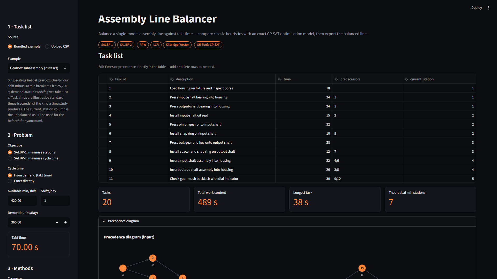 | 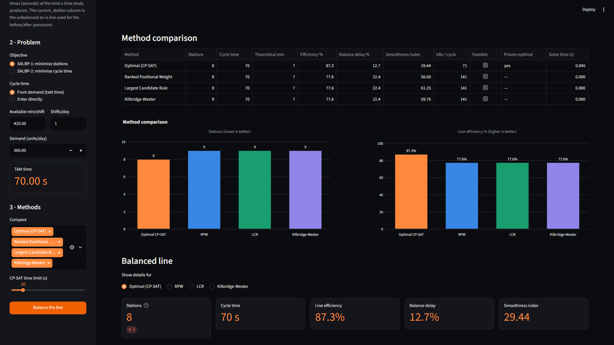 |
| **Before / after yamazumi** | **Station Gantt view** |
| 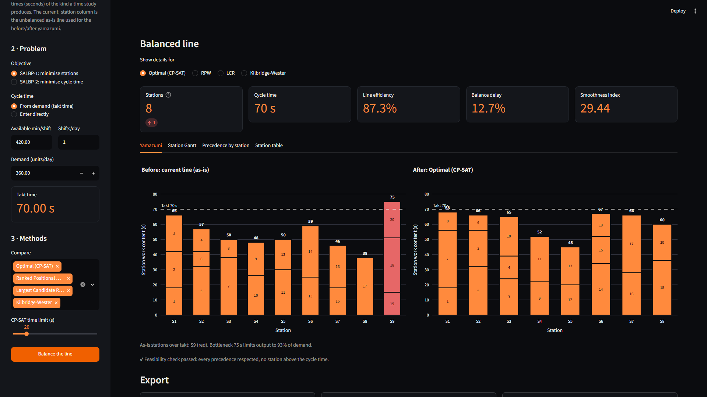 | 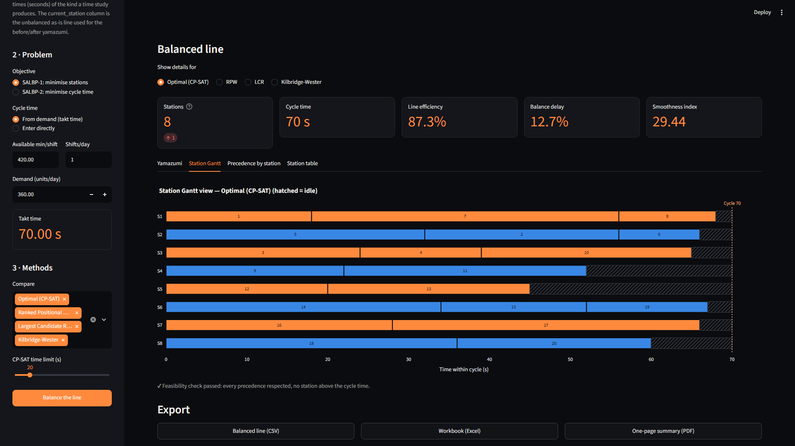 |

### Precedence diagram (gearbox, coloured by assigned station)
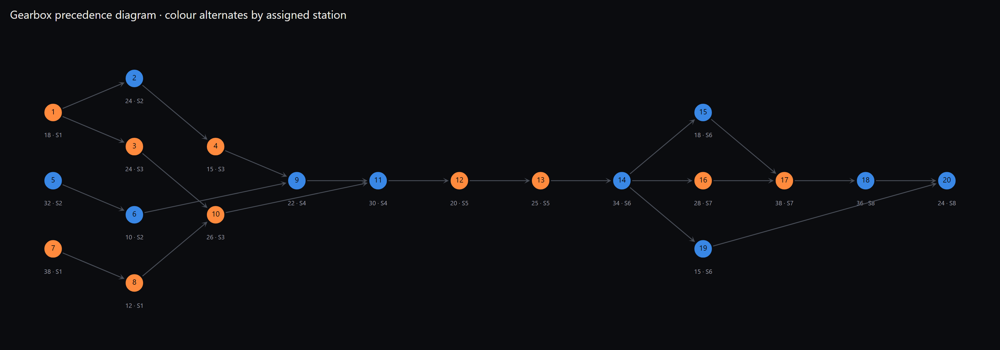

### Yamazumi: before vs after balancing, against the 70 s takt line
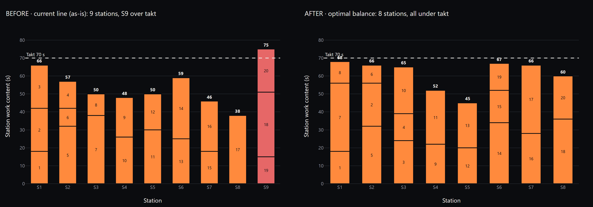

### Station Gantt view (hatched = idle time within the cycle)
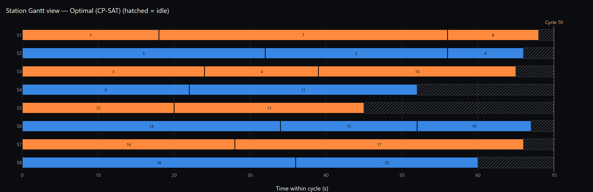

### Method comparison: gearbox at takt 70 s
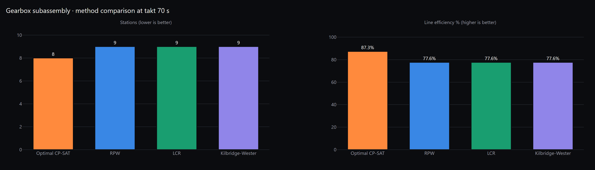

### Method comparison across 81 benchmark instances
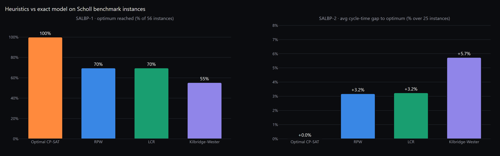

### One-page PDF summary (export)
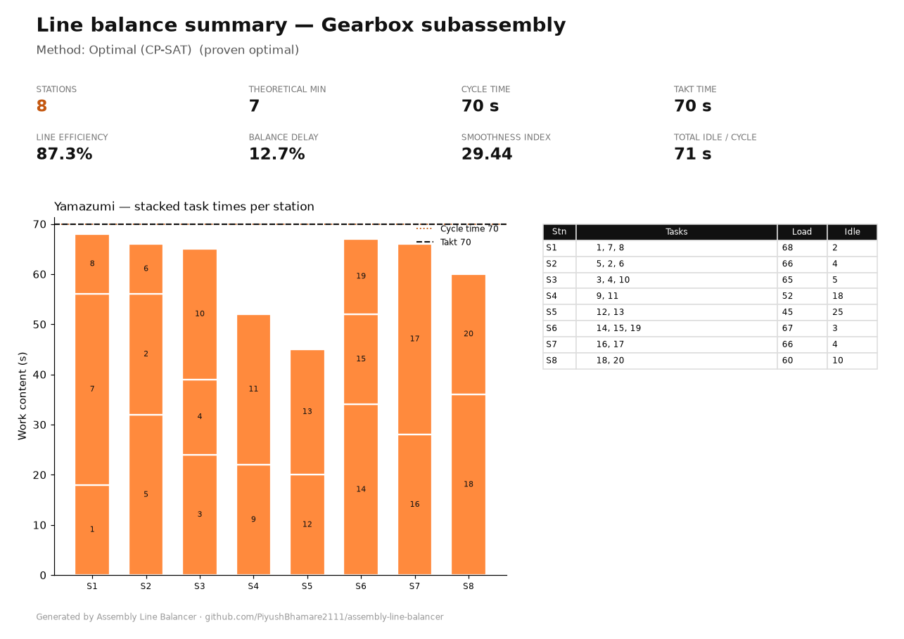

## How it works

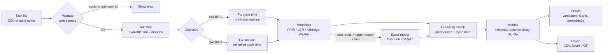

### Takt time
**Takt time = available production time ÷ customer demand.** For the gearbox: one 8-hour shift minus 30 minutes of breaks = 7 h = 25,200 s, and demand is 360 units, so takt = **70 s**. Each station must finish its work within 70 s, or the line can't keep up with demand. The longest task (38 s) must also fit within the takt, since a task can't be split across stations.

### The two problems
* **SALBP-1** (simple assembly line balancing problem, type 1): the cycle time is fixed (usually = takt), and you **minimise the number of stations**, which means minimising the number of operators. A lower bound is the *theoretical minimum* ⌈Σt / c⌉.
* **SALBP-2**: the number of stations is fixed (you have, say, 8 operators or 8 fixtures), and you **minimise the cycle time**, which maximises output. A lower bound is max(longest task, Σt / m).

### Heuristics (all station-oriented)
All three heuristics use the same loop. Open a station. Among the tasks whose predecessors are all done *and* which still fit in the station's remaining time, pick the one with the highest priority. Repeat until nothing fits, then open the next station. Only the priority rule changes:

| Heuristic | Priority rule, in plain words |
|---|---|
| **Ranked Positional Weight (RPW)** | A task's *positional weight* is its own time plus the time of **every** task that has to come after it. Tasks that hold up a lot of downstream work go first. |
| **Largest Candidate Rule (LCR)** | Longest task first. Fill each station with the big pieces, then use small tasks to fill the gaps. |
| **Kilbridge-Wester (KW)** | Arrange the precedence diagram in columns (column = length of the longest chain of predecessors). Assign tasks from the left-most column first, and the longest task first within a column. |

For SALBP-2 the heuristics start at the lower bound on cycle time and raise it in the smallest meaningful step until the line fits into *m* stations.

### Exact model (binary program solved with CP-SAT)
Decision variables: **x[i,k] = 1** if task *i* is done at station *k*, and **y[k] = 1** if station *k* is used.

* every task is assigned to exactly one station: Σₖ x[i,k] = 1
* station work content stays within the cycle time: Σᵢ tᵢ·x[i,k] ≤ c·y[k] (in SALBP-2, ≤ C, where C is a variable)
* precedence: if *i* must come before *j*, then station(i) ≤ station(j), i.e. Σₖ k·x[i,k] ≤ Σₖ k·x[j,k]
* stations are used in order (y[k] ≥ y[k+1]) to remove symmetric duplicate solutions
* **objective:** SALBP-1 minimises Σ y[k]; SALBP-2 minimises C

Two standard speed-ups make the model small. First, each task can only go to stations between an *earliest* and a *latest* station, computed from the work that must come before and after it. Second, the best heuristic result is passed in as both a starting solution and an upper bound. CP-SAT then either proves the result optimal or improves on it. Times with decimals (e.g. 12.4 s) are scaled to integers before solving.

### Metrics
| Metric | Formula | What it tells you |
|---|---|---|
| Theoretical minimum stations | ⌈Σt / c⌉ | The fewest stations possible even with perfect balance |
| Line efficiency | Σt / (m·c) | Share of paid station time that adds value |
| Balance delay | 1 − efficiency | Share of time lost to imbalance (idle) |
| Idle time per station | c − Sₖ | Where the slack is, i.e. where to move work |
| Smoothness index | √Σ(S_max − Sₖ)² | How even the stations are (0 = perfectly level) |

## Results on textbook benchmarks

These are 9 classic precedence graphs from the **Scholl (1993) SALBP benchmark data set**, with the published optimal values from the same source. That gives 56 SALBP-1 and 25 SALBP-2 instances, 81 in total. "x/y" below means the method reached the published optimum on x of y instances. Every solution from every method passes the feasibility check.

| Instance | Tasks | Problem | Instances | CP-SAT = optimum | RPW = optimum | LCR = optimum | KW = optimum | Max CP-SAT time (s) |
|---|---:|---|---:|---:|---:|---:|---:|---:|
| Mertens | 7 | SALBP-1 | 6 | 6/6 | 6/6 | 5/6 | 6/6 | 0.02 |
| Bowman | 8 | SALBP-1 | 1 | 1/1 | 1/1 | 1/1 | 1/1 | 0.01 |
| Jaeschke | 9 | SALBP-1 | 5 | 5/5 | 5/5 | 5/5 | 5/5 | 0.01 |
| Jackson | 11 | SALBP-1 | 6 | 6/6 | 5/6 | 5/6 | 5/6 | 0.02 |
| Mitchell | 21 | SALBP-1 | 6 | 6/6 | 4/6 | 6/6 | 2/6 | 0.01 |
| Heskiaoff | 28 | SALBP-1 | 6 | 6/6 | 6/6 | 3/6 | 2/6 | 0.02 |
| Buxey | 29 | SALBP-1 | 7 | 7/7 | 4/7 | 5/7 | 2/7 | 0.06 |
| Buxey | 29 | SALBP-2 | 8 | 8/8 | 1/8 | 3/8 | 0/8 | 0.14 |
| Sawyer | 30 | SALBP-1 | 9 | 9/9 | 6/9 | 6/9 | 5/9 | 0.12 |
| Sawyer | 30 | SALBP-2 | 8 | 8/8 | 1/8 | 2/8 | 0/8 | 0.11 |
| Kilbridge | 45 | SALBP-1 | 10 | 10/10 | 2/10 | 3/10 | 3/10 | 0.12 |
| Kilbridge | 45 | SALBP-2 | 9 | 9/9 | 1/9 | 2/9 | 2/9 | 0.18 |
| **All** | | **SALBP-1** | **56** | **100%** | **70%** | **70%** | **55%** | |
| **All** | | **SALBP-2** | **25** | **100%** | **12%** | **28%** | **8%** | |

Average gap to the optimum, where a heuristic misses it: SALBP-1 stations +5.1% (RPW), +5.4% (LCR), +7.6% (KW); SALBP-2 cycle time +3.2% (RPW), +3.2% (LCR), +5.7% (KW). CP-SAT proved every instance optimal in under 0.2 s on a laptop. These instances have 7–45 tasks; much larger lines (100+ tasks) may hit the time limit, and the app then reports the best solution it found as *not proven*.

<details>
<summary>Full per-instance table (81 rows; bold = equals published optimum)</summary>

| Instance | n | Problem | Given | Known optimum | CP-SAT | RPW | LCR | KW | CP-SAT time (s) |
|---|---:|---|---|---:|---:|---:|---:|---:|---:|
| Mertens | 7 | SALBP-1 | c=6 | 6 | **6** | **6** | **6** | **6** | 0.02 |
| Mertens | 7 | SALBP-1 | c=7 | 5 | **5** | **5** | **5** | **5** | 0.00 |
| Mertens | 7 | SALBP-1 | c=8 | 5 | **5** | **5** | **5** | **5** | 0.01 |
| Mertens | 7 | SALBP-1 | c=10 | 3 | **3** | **3** | 4 | **3** | 0.01 |
| Mertens | 7 | SALBP-1 | c=15 | 2 | **2** | **2** | **2** | **2** | 0.01 |
| Mertens | 7 | SALBP-1 | c=18 | 2 | **2** | **2** | **2** | **2** | 0.01 |
| Bowman | 8 | SALBP-1 | c=20 | 5 | **5** | **5** | **5** | **5** | 0.01 |
| Jaeschke | 9 | SALBP-1 | c=6 | 8 | **8** | **8** | **8** | **8** | 0.01 |
| Jaeschke | 9 | SALBP-1 | c=7 | 7 | **7** | **7** | **7** | **7** | 0.01 |
| Jaeschke | 9 | SALBP-1 | c=8 | 6 | **6** | **6** | **6** | **6** | 0.01 |
| Jaeschke | 9 | SALBP-1 | c=10 | 4 | **4** | **4** | **4** | **4** | 0.01 |
| Jaeschke | 9 | SALBP-1 | c=18 | 3 | **3** | **3** | **3** | **3** | 0.01 |
| Jackson | 11 | SALBP-1 | c=7 | 8 | **8** | **8** | **8** | **8** | 0.02 |
| Jackson | 11 | SALBP-1 | c=9 | 6 | **6** | **6** | **6** | **6** | 0.01 |
| Jackson | 11 | SALBP-1 | c=10 | 5 | **5** | 6 | 6 | 6 | 0.01 |
| Jackson | 11 | SALBP-1 | c=13 | 4 | **4** | **4** | **4** | **4** | 0.01 |
| Jackson | 11 | SALBP-1 | c=14 | 4 | **4** | **4** | **4** | **4** | 0.01 |
| Jackson | 11 | SALBP-1 | c=21 | 3 | **3** | **3** | **3** | **3** | 0.01 |
| Mitchell | 21 | SALBP-1 | c=14 | 8 | **8** | **8** | **8** | 10 | 0.01 |
| Mitchell | 21 | SALBP-1 | c=15 | 8 | **8** | **8** | **8** | 9 | 0.01 |
| Mitchell | 21 | SALBP-1 | c=21 | 5 | **5** | 6 | **5** | 6 | 0.01 |
| Mitchell | 21 | SALBP-1 | c=26 | 5 | **5** | **5** | **5** | **5** | 0.01 |
| Mitchell | 21 | SALBP-1 | c=35 | 3 | **3** | 4 | **3** | 4 | 0.01 |
| Mitchell | 21 | SALBP-1 | c=39 | 3 | **3** | **3** | **3** | **3** | 0.01 |
| Heskiaoff | 28 | SALBP-1 | c=138 | 8 | **8** | **8** | **8** | **8** | 0.02 |
| Heskiaoff | 28 | SALBP-1 | c=205 | 5 | **5** | **5** | 6 | 6 | 0.01 |
| Heskiaoff | 28 | SALBP-1 | c=216 | 5 | **5** | **5** | **5** | 6 | 0.01 |
| Heskiaoff | 28 | SALBP-1 | c=256 | 4 | **4** | **4** | 5 | 5 | 0.01 |
| Heskiaoff | 28 | SALBP-1 | c=324 | 4 | **4** | **4** | **4** | **4** | 0.01 |
| Heskiaoff | 28 | SALBP-1 | c=342 | 3 | **3** | **3** | 4 | 4 | 0.01 |
| Buxey | 29 | SALBP-1 | c=27 | 13 | **13** | 14 | **13** | 14 | 0.04 |
| Buxey | 29 | SALBP-1 | c=30 | 12 | **12** | **12** | **12** | 13 | 0.04 |
| Buxey | 29 | SALBP-1 | c=33 | 11 | **11** | **11** | 12 | 12 | 0.04 |
| Buxey | 29 | SALBP-1 | c=36 | 10 | **10** | **10** | **10** | **10** | 0.04 |
| Buxey | 29 | SALBP-1 | c=41 | 8 | **8** | 9 | **8** | 9 | 0.02 |
| Buxey | 29 | SALBP-1 | c=47 | 7 | **7** | 8 | 8 | 8 | 0.06 |
| Buxey | 29 | SALBP-1 | c=54 | 7 | **7** | **7** | **7** | **7** | 0.04 |
| Buxey | 29 | SALBP-2 | m=7 | 47 | **47** | 49 | 49 | 50 | 0.04 |
| Buxey | 29 | SALBP-2 | m=8 | 41 | **41** | 43 | **41** | 43 | 0.01 |
| Buxey | 29 | SALBP-2 | m=9 | 37 | **37** | 39 | **37** | 39 | 0.03 |
| Buxey | 29 | SALBP-2 | m=10 | 34 | **34** | 35 | 35 | 35 | 0.03 |
| Buxey | 29 | SALBP-2 | m=11 | 32 | **32** | **32** | 34 | 34 | 0.07 |
| Buxey | 29 | SALBP-2 | m=12 | 28 | **28** | 29 | 30 | 32 | 0.05 |
| Buxey | 29 | SALBP-2 | m=13 | 27 | **27** | 28 | **27** | 30 | 0.14 |
| Buxey | 29 | SALBP-2 | m=14 | 25 | **25** | 26 | 26 | 26 | 0.04 |
| Sawyer | 30 | SALBP-1 | c=25 | 14 | **14** | **14** | **14** | 15 | 0.06 |
| Sawyer | 30 | SALBP-1 | c=27 | 13 | **13** | 14 | **13** | 14 | 0.05 |
| Sawyer | 30 | SALBP-1 | c=30 | 12 | **12** | **12** | 13 | **12** | 0.07 |
| Sawyer | 30 | SALBP-1 | c=33 | 11 | **11** | **11** | **11** | **11** | 0.12 |
| Sawyer | 30 | SALBP-1 | c=36 | 10 | **10** | **10** | **10** | **10** | 0.04 |
| Sawyer | 30 | SALBP-1 | c=41 | 8 | **8** | 9 | 9 | 9 | 0.03 |
| Sawyer | 30 | SALBP-1 | c=47 | 7 | **7** | 8 | 8 | 8 | 0.03 |
| Sawyer | 30 | SALBP-1 | c=54 | 7 | **7** | **7** | **7** | **7** | 0.03 |
| Sawyer | 30 | SALBP-1 | c=75 | 5 | **5** | **5** | **5** | **5** | 0.01 |
| Sawyer | 30 | SALBP-2 | m=7 | 47 | **47** | 49 | 48 | 48 | 0.05 |
| Sawyer | 30 | SALBP-2 | m=8 | 41 | **41** | 43 | 45 | 47 | 0.05 |
| Sawyer | 30 | SALBP-2 | m=9 | 37 | **37** | 40 | **37** | 41 | 0.06 |
| Sawyer | 30 | SALBP-2 | m=10 | 34 | **34** | 35 | 35 | 35 | 0.11 |
| Sawyer | 30 | SALBP-2 | m=11 | 31 | **31** | 32 | 33 | 33 | 0.06 |
| Sawyer | 30 | SALBP-2 | m=12 | 28 | **28** | 30 | 31 | 30 | 0.06 |
| Sawyer | 30 | SALBP-2 | m=13 | 26 | **26** | 28 | 27 | 30 | 0.08 |
| Sawyer | 30 | SALBP-2 | m=14 | 25 | **25** | **25** | **25** | 26 | 0.04 |
| Kilbridge | 45 | SALBP-1 | c=56 | 10 | **10** | 11 | 11 | 11 | 0.06 |
| Kilbridge | 45 | SALBP-1 | c=57 | 10 | **10** | **10** | **10** | **10** | 0.05 |
| Kilbridge | 45 | SALBP-1 | c=62 | 9 | **9** | 10 | 10 | 10 | 0.05 |
| Kilbridge | 45 | SALBP-1 | c=69 | 8 | **8** | 9 | 9 | 9 | 0.10 |
| Kilbridge | 45 | SALBP-1 | c=79 | 7 | **7** | 8 | 8 | 8 | 0.09 |
| Kilbridge | 45 | SALBP-1 | c=92 | 6 | **6** | 7 | 7 | 7 | 0.12 |
| Kilbridge | 45 | SALBP-1 | c=110 | 6 | **6** | **6** | **6** | **6** | 0.04 |
| Kilbridge | 45 | SALBP-1 | c=111 | 5 | **5** | 6 | 6 | **5** | 0.03 |
| Kilbridge | 45 | SALBP-1 | c=138 | 4 | **4** | 5 | 5 | 5 | 0.05 |
| Kilbridge | 45 | SALBP-1 | c=184 | 3 | **3** | 4 | **3** | 4 | 0.02 |
| Kilbridge | 45 | SALBP-2 | m=3 | 184 | **184** | 186 | **184** | 185 | 0.02 |
| Kilbridge | 45 | SALBP-2 | m=4 | 138 | **138** | 139 | 147 | 147 | 0.04 |
| Kilbridge | 45 | SALBP-2 | m=5 | 111 | **111** | 112 | 116 | **111** | 0.03 |
| Kilbridge | 45 | SALBP-2 | m=6 | 92 | **92** | 93 | 94 | 93 | 0.05 |
| Kilbridge | 45 | SALBP-2 | m=7 | 79 | **79** | 81 | 80 | 80 | 0.06 |
| Kilbridge | 45 | SALBP-2 | m=8 | 69 | **69** | 71 | 71 | 75 | 0.18 |
| Kilbridge | 45 | SALBP-2 | m=9 | 62 | **62** | 63 | 63 | 65 | 0.04 |
| Kilbridge | 45 | SALBP-2 | m=10 | 56 | **56** | 57 | 57 | 57 | 0.04 |
| Kilbridge | 45 | SALBP-2 | m=11 | 55 | **55** | **55** | **55** | **55** | 0.06 |

</details>

## Run it on Windows (step by step)

You need **Python 3.10+** (developed on 3.12) and **Git**. No other system software is required: the graph drawing is pure Python (Plotly), and the solver ships as a pip wheel.

1. **Open PowerShell** (Start menu, type *PowerShell*, Enter).
2. **Clone the repo** and go into it:
   ```powershell
   git clone https://github.com/PiyushBhamare2111/assembly-line-balancer.git
   cd assembly-line-balancer
   ```
3. **Create a virtual environment.** If `python` is not on your PATH, use the full path, e.g. `& "$env:LOCALAPPDATA\Programs\Python\Python312\python.exe" -m venv .venv`, or use the launcher: `py -3.12 -m venv .venv`.
   ```powershell
   python -m venv .venv
   ```
4. **Activate it** (the prompt will start with `(.venv)`):
   ```powershell
   .\.venv\Scripts\Activate.ps1
   ```
   If PowerShell says *running scripts is disabled*, run this once and then activate again:
   `Set-ExecutionPolicy -Scope CurrentUser -ExecutionPolicy RemoteSigned`.
   (In the old `cmd.exe`, use `.venv\Scripts\activate.bat` instead.)
5. **Install the dependencies:**
   ```powershell
   python -m pip install --upgrade pip
   pip install -r requirements.txt
   ```
6. **Start the app:**
   ```powershell
   streamlit run app.py
   ```
7. **Open <http://localhost:8501>** in your browser (it usually opens by itself). Pick an example in the sidebar, then click **Balance the line**.
8. To stop the app, press **Ctrl + C** in PowerShell. Next time you only need steps 4 and 6.

### CSV format
```csv
task_id,description,time,predecessors
A,First operation,5,
B,Second operation,3,A
C,Third operation,4,A
D,Joins B and C,6,B;C
```
* `task_id` (required): any text or number, unique.
* `time` (required): standard time of the work element, in any unit used consistently (seconds in the gearbox example). Decimals are fine.
* `predecessors`: the *immediate* predecessors. Separate several with `;` (commas, `|` or spaces also work). Leave it blank for tasks with no predecessors.
* `description` (optional): a description of the work element.
* `current_station` (optional): the station each task is done at on today's line. If present, the app draws a **before / after** yamazumi.

A template is at [`data/sample_tasks_template.csv`](data/sample_tasks_template.csv). Column names are matched loosely (`id`, `duration`, `preds`, … also work).

## Tests

```powershell
.\.venv\Scripts\Activate.ps1
python -m pytest -q
```
114 tests, under a minute in total (most of that is the Streamlit app tests). They cover:
* **precedence feasibility** of every solution from every method on every benchmark instance
* **no station exceeds the cycle time**
* the **CP-SAT model hits the published optimum** on all 56 SALBP-1 and 25 SALBP-2 instances, and is proven optimal
* heuristics give feasible answers, including with fractional task times, and the priority rules choose the expected tasks
* **metrics checked against a hand-computed example** (efficiency, balance delay, smoothness index, idle times)
* **cycle detection** in the precedence input (direct cycles, self-loops, unknown predecessors, cycles in an uploaded CSV)
* CSV parsing, Excel/CSV/PDF export, and chart construction
* `tests/test_app.py` drives the real Streamlit app headlessly (`streamlit.testing.AppTest`). It solves **every bundled problem for both SALBP-1 and SALBP-2** and opens every method's detail view, failing on any exception or error message.

## Project structure

```
assembly-line-balancer/
├── app.py                      # Streamlit app
├── linebalance/
│   ├── model.py                # Task, Problem (graph, cycle detection), Solution, feasibility check
│   ├── heuristics.py           # RPW, LCR, Kilbridge-Wester (SALBP-1 and SALBP-2)
│   ├── optimal.py              # exact CP-SAT models for SALBP-1 / SALBP-2
│   ├── metrics.py              # efficiency, balance delay, smoothness index, idle time
│   ├── solve.py                # run any set of methods side by side
│   ├── viz.py                  # Plotly charts (dark theme) + Matplotlib PDF page
│   └── io.py                   # CSV parsing, bundled examples, CSV/Excel/PDF export
├── data/
│   ├── gearbox_subassembly.csv # realistic 20-task example with an as-is line
│   ├── examples.json           # demand / available time for the realistic example
│   ├── sample_tasks_template.csv
│   └── benchmarks/             # 9 Scholl instances as CSV + optima.json (published optima)
├── scripts/
│   ├── convert_scholl.py       # rebuilds data/benchmarks from the original Scholl files
│   ├── make_docs.py            # regenerates every chart in docs/ + the results table
│   └── screenshots.py          # app screenshots with headless Chromium (Playwright)
├── tests/                      # pytest suite (solver + app)
└── docs/                       # images used in this README; docs/media = 1920x1080 showcase PNGs
```

To regenerate the images: `pip install -r requirements-dev.txt`, `python -m playwright install chromium`, then `python scripts/make_docs.py`. For the app screenshots, start the app on port 8517 and run `python scripts/screenshots.py`.

## From the shop floor to this tool

| On the shop floor | In this tool |
|---|---|
| Time study: break the job into work elements and get a standard time for each | The task list (`time` column). Use your observed standard times, including allowances. |
| Precedence: "you can't torque the cover before the sealant is on" | `predecessors`, shown as the precedence diagram |
| Takt from the customer schedule | Available time ÷ demand in the sidebar |
| Yamazumi board, with work stacked per operator against the takt line | The yamazumi tab, with a **before / after** view from the `current_station` column |
| Kaizen: move elements off the bottleneck, merge low-loaded stations | The solvers do this rebalancing systematically. CP-SAT proves when no fewer stations are possible. |
| Line-balance KPIs for the A3 / report-out | Efficiency, balance delay, smoothness index, plus the one-page PDF summary |
| Standard work / SOP update | The exported station assignment (CSV/Excel) is the input to the new standard work sheets |

Practical notes: balancing only shows where work *should* go. Before you roll out a new balance, check for zoning constraints (both sides of the part, tools fixed to a station), operator skill, and ergonomic loading. Keep each station's loading a little under takt (85–95%) so normal variation doesn't stop the line.

## Data sources and references

* **Benchmark data:** Scholl, A. (1993). *Data of Assembly Line Balancing Problems*. Schriften zur Quantitativen Betriebswirtschaftslehre 16/93, TH Darmstadt. Files and optimal values were downloaded from <https://assembly-line-balancing.de/salbp/benchmark-data-sets-1993/> (`SALBP-data-sets.zip`). They were converted with `scripts/convert_scholl.py`, and task-time totals were checked against the published table. Original sources of the graphs: Jackson (1956), Mertens (1967), Bowman (1960), Jaeschke (1964), Mitchell (1957), Heskiaoff (1968), Buxey (1974), Sawyer (1970), Kilbridge & Wester (1961).
* Scholl, A. (1999). *Balancing and Sequencing of Assembly Lines*, 2nd ed. Physica-Verlag.
* Helgeson, W.B. & Birnie, D.P. (1961). Assembly line balancing using the ranked positional weight technique. *Journal of Industrial Engineering* 12(6), 394–398.
* Kilbridge, M.D. & Wester, L. (1961). A heuristic method of assembly line balancing. *Journal of Industrial Engineering* 12(4), 292–298.
* Moodie, C.L. & Young, H.H. (1965). A heuristic method of assembly line balancing for assumptions of constant or variable work element times. *Journal of Industrial Engineering* 16, 23–29 (smoothness index).
* Groover, M.P. *Automation, Production Systems, and Computer-Integrated Manufacturing*, chapter on manual assembly lines (efficiency and balance delay definitions).
* Patterson, J.H. & Albracht, J.J. (1975). Assembly-line balancing: zero-one programming with Fibonacci search. *Operations Research* 23(1), 166–172 (binary formulation).
* Google OR-Tools CP-SAT solver: <https://developers.google.com/optimization>.
* Inspiration (no code reused): [RahulShagri/Interactive-Assembly-Line-Balancer](https://github.com/RahulShagri/Interactive-Assembly-Line-Balancer), [GuilleMunoz/Assembly_Line_Balancing_Problem](https://github.com/GuilleMunoz/Assembly_Line_Balancing_Problem).

The gearbox task list is an illustrative example written for this project; its times are realistic but not measured on a specific line.

## License

[MIT](LICENSE) © 2026 Piyush Bhamare
